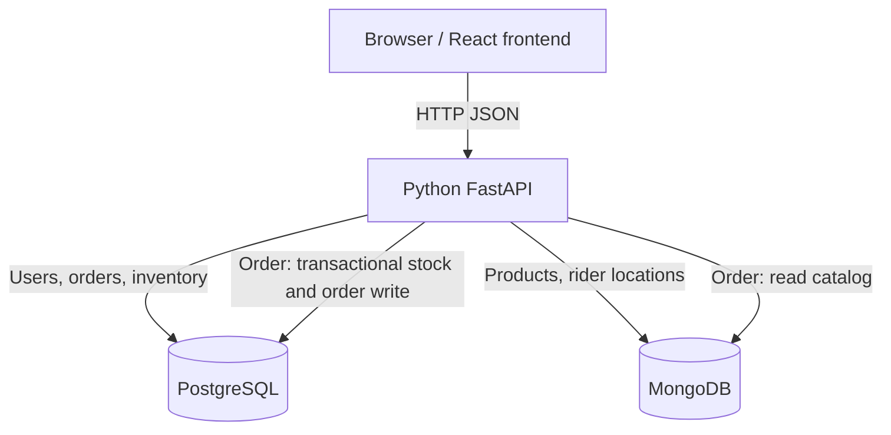
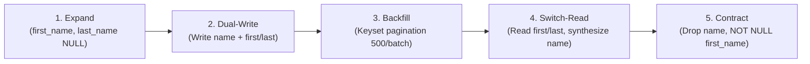
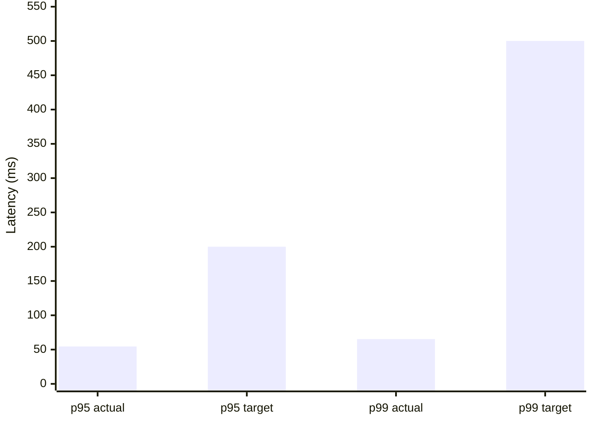
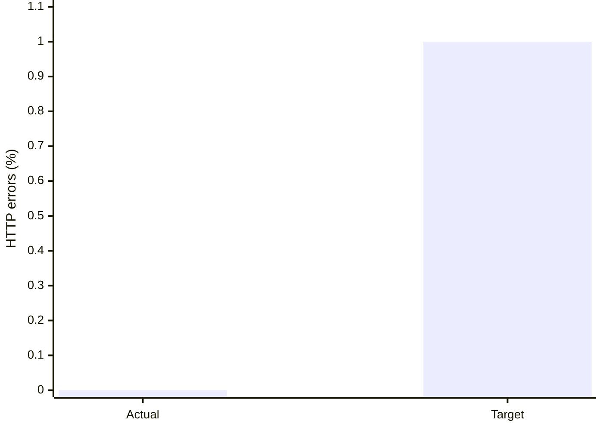
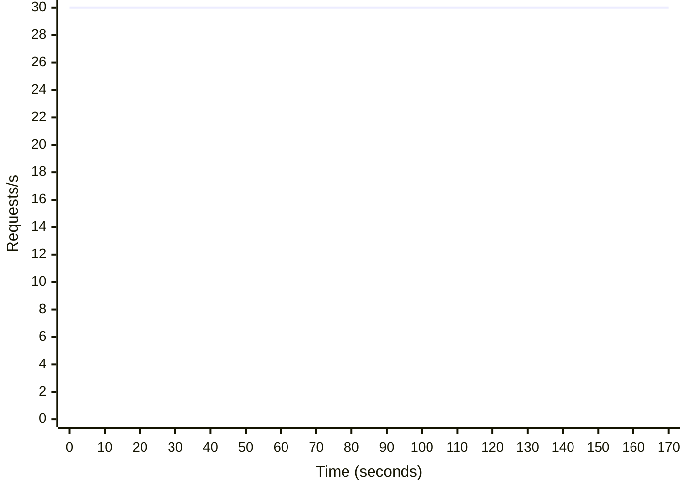

# DeliveryApp

Food delivery around Chiang Mai University. The Checkpoint 1 backend connects FastAPI to PostgreSQL for accounts, orders, and inventory, and to MongoDB for products and rider locations.

## Team and contributions

The roster below uses the student details provided by the team and links each person to their Git identity.

| Student ID | Member / Git identity | Current responsibility and contribution |
| --- | --- | --- |
| 670615020 | Jirasak Boonsom / Jirasak | Project setup, Orders API, integration, Products API, CP1 verification |
| 670615035 | Supanat Pudhom / beam2548 | Users API, account migration, PostgreSQL seed and tests |
| 650615037 | Anakin arsa / Anakin_Arsa | Project planning and handoff documentation |

Each member should continue contributing through a feature branch and a reviewed pull request. The Git history, not this table alone, is the evidence of individual work.

## Architecture



PostgreSQL owns transactional state. MongoDB owns flexible catalog documents and location telemetry. Product IDs match PostgreSQL inventory IDs. Creating a product writes to PostgreSQL first and MongoDB second; these writes are not a distributed atomic transaction. On a MongoDB failure, the API removes the new inventory row, and `scripts.verify_seed` detects catalog/inventory mismatches after an interrupted write. Order creation reads a product snapshot from MongoDB and commits stock and order rows together in PostgreSQL.

## Local setup

Install Git and Docker Desktop. Clone the repository and create a local environment file:

```bash
cp .env.example .env
```

On PowerShell, use `Copy-Item .env.example .env`. Replace every `replace-with...` or `change-me...` value in `.env` with your own local values. In particular, set a long `AUTH_SECRET` and a demo `SEED_USER_PASSWORD` of at least eight characters. `.env` is ignored by Git. The database port defaults are 5432 and 27017; change `POSTGRES_PORT` or `MONGO_PORT` in `.env` if those host ports are occupied.

Start the stack, seed both databases, and verify the data:

```bash
docker compose up -d --build --wait
docker compose exec -T api python -m scripts.seed
docker compose exec -T api python -m scripts.verify_seed
docker compose ps
```

The API container applies the Alembic migration history on startup. To apply a later migration manually, run `docker compose exec -T api alembic upgrade head`. Do not run a second copy of the same DDL manually. Named Docker volumes preserve data after `docker compose down`; seeding can be rerun without resetting existing stock, prices, or passwords.

| Service | Default local URL |
| --- | --- |
| Frontend setup page | http://localhost:5173 |
| API and Swagger | http://localhost:8000/docs |
| API health | http://localhost:8000/health |
| PostgreSQL | localhost:5432 |
| MongoDB | localhost:27017 |

The frontend is currently a setup page. Checkpoint 1 is a backend milestone; the customer UI and live rider map are later work.

## API endpoint summary

| Method | Route | Purpose and database |
| --- | --- | --- |
| POST | `/api/v1/users` | Register a customer or rider in PostgreSQL |
| POST | `/api/v1/auth/login` | Get a bearer token for a seeded or registered user |
| GET | `/api/v1/users/{id}` | Read your own profile from PostgreSQL |
| GET | `/api/v1/products?restaurant_id={uuid}&limit=20&offset=0` | Paginated MongoDB catalog |
| POST | `/api/v1/products` | Merchant/admin token required; create MongoDB product and PostgreSQL inventory |
| POST | `/api/v1/orders` | Customer token and `Idempotency-Key` required; read MongoDB, write PostgreSQL transaction |
| GET | `/api/v1/orders`, `/api/v1/orders/{id}` | Read your own PostgreSQL orders |
| POST | `/api/v1/orders/{id}/cancel` | Cancel a placed order and restore stock once |

The seed creates `merchant@cmu.example` with the local `SEED_USER_PASSWORD`; log in with this account to create products. Register a customer through `POST /api/v1/users`, then log in as that customer to place orders. Product creation accepts `restaurant_id`, `name`, integer `price_satang`, integer `initial_stock`, and a flexible `attributes` object. See [the API contract](docs/api-contract.md) for request and response details.

## Verification and demo

```bash
docker compose exec -T api python -m unittest discover -s tests -p "test_*.py"
docker compose exec -T api python -m scripts.smoke_cp1
docker compose exec -T api python -m scripts.smoke_orders
```

The CP1 smoke test exercises all five required routes through HTTP and cleans up its temporary data. The Orders smoke test covers retries, stock conflicts, authorization, concurrency, and cancellation. GitHub Actions runs these checks against fresh Compose volumes on each pull request and push to `main`.

To verify Checkpoint 1, use the [testing guide](docs/cp1-testing.md). The [submission guide](docs/cp1-submission.md) maps each requirement to repository evidence and explains the assignment upload. See [the data model](docs/data-model.md), [decisions](docs/decisions.md), and [backlog](docs/backlog.md) for design notes.

## Checkpoint 2: Zero-Downtime Migration (Expand-Contract)

CP2 migrates `users.name` into `first_name` and `last_name` without application downtime, 5xx errors, or data loss while background traffic ($\ge 20$ req/s) is continuously executing.



### Zero-Downtime Migration Rehearsal & Verification

Run the automated 5-phase rehearsal demo while the traffic generator sends concurrent requests:

```bash
docker compose exec -T api python -m scripts.demo_cp2
```

Or execute individual phases step-by-step:

```bash
# Start background traffic generator (runs for 60s at 25 req/s)
docker compose exec -T api python -m scripts.traffic_gen --duration 60 --rate 25 &

# 1. Expand phase
docker compose exec -T api alembic upgrade head
docker compose exec -T api python -m scripts.set_migration_phase expand

# 2. Dual-write phase
docker compose exec -T api python -m scripts.set_migration_phase dual_write

# 3. Backfill phase with keyset pagination
docker compose exec -T api python -m scripts.set_migration_phase backfill
docker compose exec -T api python -m scripts.backfill_user_names
docker compose exec -T api python -m scripts.verify_backfill

# 4. Switch-read phase
docker compose exec -T api python -m scripts.set_migration_phase switch_read

# 5. Contract phase
docker compose exec -T api python -m scripts.run_contract
docker compose exec -T api python -m scripts.verify_backfill
```

### Assignment Submissions

- **CP1 Submission**: `python tools/package_cp1.py` -> `dist/DeliveryApp_CP1_submission.zip`
- **CP2 Submission**: `python tools/package_cp2.py` -> `dist/DeliveryApp_CP2_submission.zip`

## Checkpoint 3: concurrency and performance audit

Order creation protects shared inventory with PostgreSQL row locks (`SELECT ... FOR UPDATE`) inside the order transaction. Stock is checked and decremented while those locks are held, so only one transaction can purchase the final unit. Order cancellation also locks its order row before restoring stock.

`GET /api/v1/orders` selects only response fields and order-item fields in one `LEFT JOIN` query. It paginates orders before joining their items and groups the returned rows in memory, avoiding per-order queries while preserving the response format.

`GET /api/v1/products` uses a MongoDB field projection for the public product fields and an index on `(restaurant_id, active, _id)`. `GET /api/v1/users/{user_id}` and the login endpoint select only their response/authentication fields from PostgreSQL.

### Concurrency verification

With the Compose services running and migrations applied, run the dedicated 20-request last-unit race test:

```bash
docker compose exec -T api python -m scripts.test_concurrency
```

It creates disposable test records, sends 20 simultaneous orders for one unit, and expects exactly one `201` and 19 `409` responses. It removes its records afterward. GitHub Actions runs this test against the Compose integration stack as well as the two-request race in `scripts.smoke_orders`.

### Automated load test

Prepare an active customer bearer token, a restaurant ID, and 50 distinct active product IDs from that restaurant with available stock. Each VU uses a different inventory row. Every k6 iteration reads the latest page of orders, creates a fresh order using a unique idempotency key, then cancels that order once; it does not reuse an order ID. The VUs start in a staggered pattern and pace each read/create/cancel cycle at 5 seconds by default (`ITERATION_PERIOD_MS` is configurable) to produce steady load without synchronized write bursts. Generate a new run ID for every benchmark so idempotency keys cannot replay orders from an earlier test. Run from the repository root. This PowerShell command runs k6 in Docker Desktop without installing it on the host:

```powershell
$env:API_TOKEN = "<customer bearer token>"
$env:RESTAURANT_ID = "<restaurant UUID>"
$env:PRODUCT_IDS = "<50 comma-separated active product UUIDs>"
$env:RUN_ID = [guid]::NewGuid().ToString("N")
docker run --rm --network deliveryapp_default `
  -e "API_URL=http://api:8000/api/v1/orders" `
  -e "API_TOKEN=$env:API_TOKEN" `
  -e "RESTAURANT_ID=$env:RESTAURANT_ID" `
  -e "PRODUCT_IDS=$env:PRODUCT_IDS" `
  -e "RUN_ID=$env:RUN_ID" `
  -v "${PWD}:/work" -w /work grafana/k6:latest run ./k6_script.js
```

The script runs 50 virtual users for three minutes. k6 enforces p95 < 200 ms and p99 < 500 ms for overall requests and separately for order-list reads, order creation, and cancellation, with HTTP errors < 1% and checks > 99%. The report evaluates RPS stability over the middle 160 seconds and marks it as passing only when the max-to-min 10-second window spread is below 20% of the mean. Each run generates `cp3-k6-report.md` with throughput by 10-second interval, latency/error metrics, and Mermaid charts, plus `cp3-k6-summary.json` with the raw k6 summary.

The API reuses its PostgreSQL connection pool and MongoDB client across requests. It starts four Uvicorn workers by default (`API_WORKERS=4`), with a PostgreSQL pool of 2–20 connections per worker (`DB_POOL_MIN_SIZE=2`, `DB_POOL_MAX_SIZE=20`). This caps the API's PostgreSQL pools at 80 connections so they leave room under PostgreSQL's default 100-connection limit. Tune the worker and pool settings together for the deployment size.


### CP3 performance evidence

Latest local Compose benchmark: 50 VUs for 180 seconds. Each VU runs one order-list read, fresh order creation, and cancellation every five seconds using its own inventory row. Full k6 output and charts are in [cp3-k6-report.md](cp3-k6-report.md); raw summary is in [cp3-k6-summary.json](cp3-k6-summary.json).

| Metric | Result | CP3 target | Status |
| --- | ---: | ---: | --- |
| Load profile | 50 VUs for 180 seconds | 50 VUs for 180 seconds | Pass |
| Read/write flow | 1,800 reads; 1,800 orders created and cancelled | Concurrent read/write transactions | Pass |
| Throughput | 29.20 requests/s; 30.00–30.00 across 10-second windows (0.0% spread) | Stable RPS | Pass |
| Overall p95 | 54.49 ms | < 200 ms | Pass |
| Overall p99 | 65.26 ms | < 500 ms | Pass |
| Order-list read p95 / p99 | 8.43 / 14.41 ms | < 200 / < 500 ms | Pass |
| Create p95 / p99 | 57.71 / 75.90 ms | < 200 / < 500 ms | Pass |
| Cancel p95 / p99 | 54.89 / 62.23 ms | < 200 / < 500 ms | Pass |
| HTTP errors | 0.000% | < 1% | Pass |
| Check pass rate | 100.00% | > 99% | Pass |







The earlier write-only baseline from commit `75b6265` is retained in project history: it had no reads, p95 537.14 ms, and p99 1,014.01 ms. The table and charts above report the current mixed read/write run.
