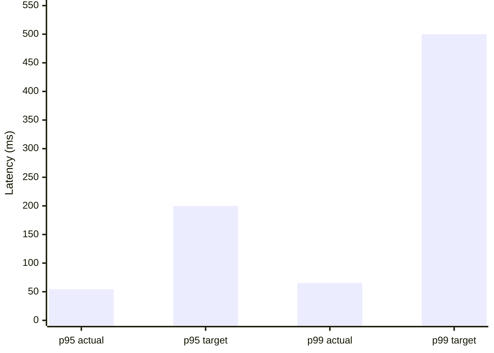
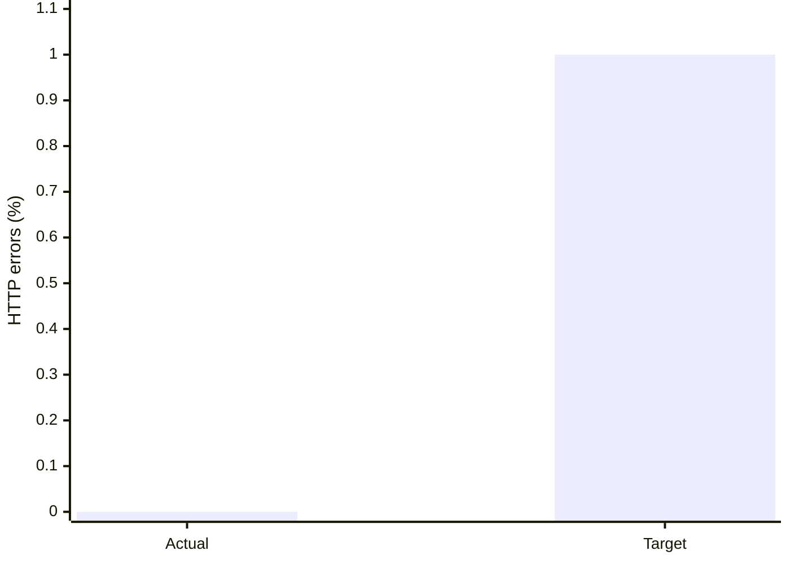
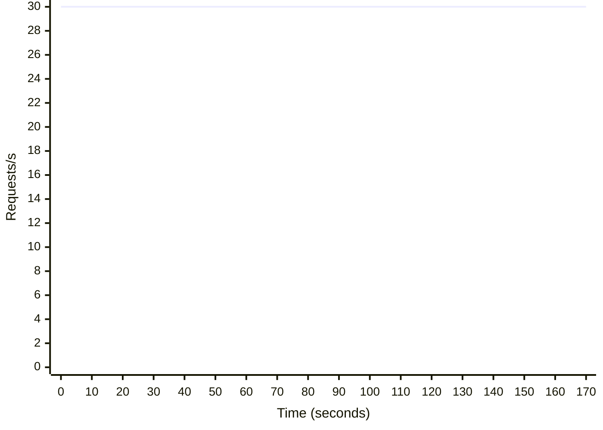

# CP3 k6 Performance Results

| Metric | Result | Target | Status |
| --- | ---: | ---: | --- |
| Load profile | 50 VUs for 180 seconds (185 seconds total incl. graceful stop) | 50 VUs for 180 seconds | Pass |
| Requests | 5400 total | — | Recorded |
| Read transactions | 1800 successful order-list reads | At least one read per write iteration | Pass |
| Fresh orders | 1800 created / 1800 cancelled | Each create gets one cancel | Pass |
| Throughput | 29.20 requests/s | — | Recorded |
| Steady 10-second RPS range | 30.00-30.00 requests/s (0.0% of mean) | Spread < 20% across middle 160 seconds | Pass |
| p95 latency | 54.49 ms | < 200 ms | Pass |
| p99 latency | 65.26 ms | < 500 ms | Pass |
| Order-list read p95 / p99 | 8.43 / 14.41 ms | < 200 / < 500 ms | Pass |
| Create order p95 / p99 | 57.71 / 75.90 ms | < 200 / < 500 ms | Pass |
| Cancel order p95 / p99 | 54.89 / 62.23 ms | < 200 / < 500 ms | Pass |
| HTTP error rate | 0.000% | < 1% | Pass |
| Check pass rate | 100.00% | > 99% | Pass |
| Overall CP3 load result | Pass | Load profile, read/write mix, stable RPS, latency, and errors | Pass |

Each iteration reads the latest page of up to 20 orders, creates a new order with a unique idempotency key, and cancels it once. The 50 VUs each use a different product/inventory row to avoid serializing all writes on one stock row. Their first transactions are staggered across a 5.0-second cycle, and each VU starts at most one transaction per cycle to avoid synchronized bursts. Supply 50 distinct active product IDs for the same restaurant, each with stock available throughout the run. Throughput stability excludes the first and last 10-second bins and requires the min-to-max spread to remain below 20% of the mean across the middle 160 seconds.

Test deployment: API and databases in Docker Compose, with k6 running in the Grafana k6 container on Windows.

## Latency chart

## Error-rate chart

## Request throughput over time

